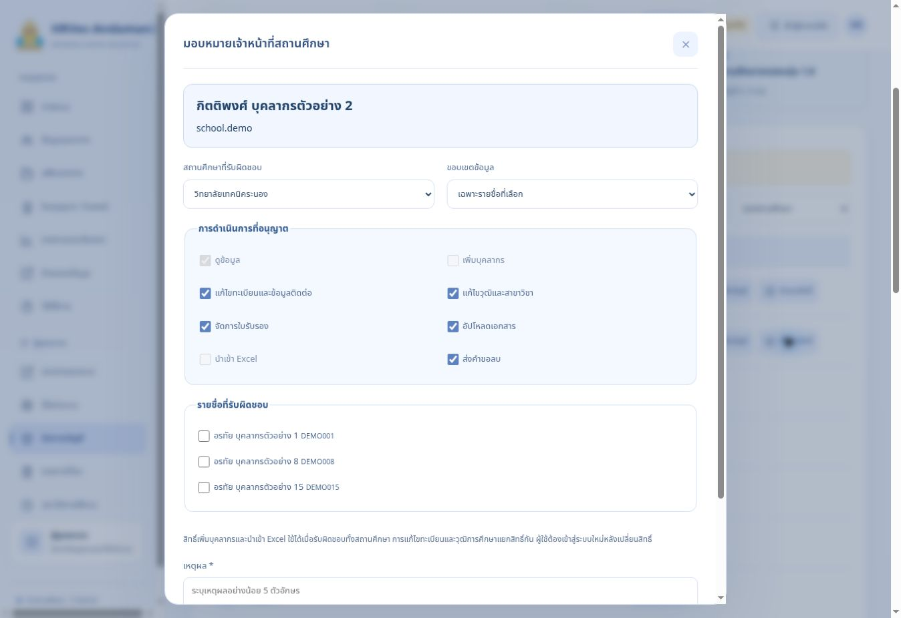

# HRVec-Andaman2 รุ่น 1.8 — คู่มืออัปเกรดและใช้งาน

จัดทำ 22 ตุลาคม 2569

## สถานะการอัปเกรด 22 ตุลาคม 2569

ชุดนี้มีโค้ดหน้าเว็บ ฐานข้อมูล ฟังก์ชันหลังบ้าน Apps Script และการทดสอบครบสำหรับรุ่น 1.8 หน้าสาธิตใช้ข้อมูลสมมติในเบราว์เซอร์

**อัปเกรดฐานข้อมูลจริงและเผยแพร่ Edge Functions รุ่น 1.8 แล้ว** ตามการอนุญาตของเจ้าของโครงการ ตรวจฐานข้อมูลได้ `1.8.0` และฟังก์ชันทั้งสองเป็น `ACTIVE` หมายเลข Deployment 5 ของ Supabase เป็นลำดับการเผยแพร่ ไม่ใช่เลขรุ่นแอป

| ส่วนระบบ | ผลตรวจจริง |
|---|---|
| ฐานข้อมูล | รุ่น 1.8.0; migration `20261022083857_school_delegation_v18` |
| hr-bridge / hr-accounts | ACTIVE ทั้งคู่; Deployment version 5 |
| ข้อมูลเดิม | สถานศึกษา 7 แห่ง บัญชี 2 บัญชีคงอยู่ครบ; ยังไม่มีทะเบียนบุคลากรหรือเอกสารในฐานข้อมูลนี้ |
| สิทธิ์ใหม่ | RLS เปิดทั้ง 2 ตาราง; ไม่มอบหมายสิทธิ์ให้บุคคลจริงและไม่รีเซ็ตรหัสเดิม |
| ตรวจ HTTP | ผ่าน 14 กรณี: Origin ที่อนุญาต, ไม่มีเซสชัน, เซสชันไม่ถูกต้อง, Origin ที่ไม่ได้อนุญาต |
| การใช้งานครบวงจร | ยังไม่ได้เข้าสู่ระบบด้วยบัญชีจริงหรือทดสอบไฟล์ Google Drive |

**สำหรับโครงการ HR นี้ ไม่ต้องรัน SQL หรือ Deploy ฟังก์ชันซ้ำ** ขั้นตอนที่ 2–3 ด้านล่างเก็บไว้สำหรับตรวจสอบหรือติดตั้งใหม่ งานที่เหลือคืออัปเดตหน้าเว็บ GitHub Pages ตามขั้นตอนที่ 5 อัปเดต Apps Script ตามขั้นตอนที่ 4 แล้วเข้าสู่ระบบด้วยบัญชีเดิมเพื่อมอบหมายเจ้าหน้าที่และตรวจรับตามขั้นตอนที่ 6–10 หน้าสาธิตในแชตยังใช้ข้อมูลสมมติ

โครงการ HR ที่ถูกต้องคือ `oftlfxiywhtoftxluviv` ไม่ใช้โครงการเก่า `unbxltvodbcesqcmorjk`

## 1. เปิดไฟล์และเตรียมโปรแกรม

| งาน | โปรแกรม | จุดที่เปิด |
|---|---|---|
| แตกไฟล์ | File Explorer | คลิกขวา ZIP → Extract All |
| เปิดโค้ด | VS Code | File → Open Folder เลือกโฟลเดอร์ที่มี package.json |
| ปรับฐานข้อมูล | Chrome หรือ Edge | Supabase Dashboard → โครงการ HR → SQL Editor |
| Deploy ฟังก์ชัน | VS Code Terminal | Terminal → New Terminal ใช้ Command Prompt หรือ npx.cmd ใน PowerShell |
| ส่งหน้าเว็บ | VS Code และ GitHub | Source Control → Commit → Sync Changes |
| ปรับระบบ Google | Chrome หรือ Edge | โครงการ Apps Script เดิม |

ZIP สำหรับ GitHub ใช้โครงสร้างรากโดยตรง ต้องพบ `package.json`, `dist`, `supabase`, `apps-script`, `scripts`, `tests`, `docs`, `deployment`, `.github`, `.gitignore`, `.env.example` อย่าอัปโหลด ZIP เป็นไฟล์เดียวหรือสร้างโฟลเดอร์ครอบซ้ำ หากไม่เห็นไฟล์ที่ขึ้นต้นด้วยจุด ให้เปิด File Explorer → View → Show → Hidden items

เก็บสำเนาโค้ดรุ่นเดิมและค่าการเชื่อมต่อก่อนอัปเกรด หากมีข้อมูลจริงแล้วให้สำรองฐานข้อมูลและไฟล์ Drive ด้วย การสำรอง JSON ของแอปเก็บทะเบียนและรายการอ้างอิงไฟล์ ไม่ได้คัดลอกไฟล์แนบทั้งหมดและไม่ได้สำรองรหัสผ่าน Auth

## 2. อัปเกรดฐานข้อมูลเดิมจากรุ่น 1.7

ใช้ Chrome หรือ Edge เปิด https://supabase.com/dashboard/project/oftlfxiywhtoftxluviv

1. เลือก SQL Editor → New query
2. ใช้ VS Code เปิด `supabase/migrations/20261022083857_school_delegation_v18.sql`
3. คัดลอกทั้งไฟล์ไปวางใน SQL Editor ของโครงการ HR
4. สำหรับฐานข้อมูลเดิมรุ่น 1.7 ที่ยังไม่อัปเกรดและได้รับอนุญาตแล้ว กด Run หนึ่งครั้ง โครงการ HR นี้ทำเสร็จแล้ว ให้ใช้คำสั่งตรวจในข้อถัดไปแทน
5. ตรวจด้วยคำสั่งต่อไปนี้ ต้องได้ `1.8.0`

```sql
select public.hr_schema_version();
```

6. Table Editor ต้องมีตารางเดิมครบ และเพิ่ม `school_assignments`, `administration_changes`
7. ตาราง `schools` เพิ่ม `is_active` และ `revision` รหัสสถานศึกษาและบัญชีเดิมคงอยู่

**ฐานข้อมูลเดิมห้ามรัน schema.sql ติดตั้งทับ และห้ามรัน migration รุ่น 1.7 ตามหลังรุ่น 1.8** เพราะจะนำกฎเดิมกลับมาใช้ สำหรับโครงการใหม่ว่างเท่านั้นให้ใช้ `supabase/schema.sql` ฉบับเต็ม ซึ่งรวมรุ่น 1.8 แล้ว

หากต้องการตรวจว่าติดตั้งฟังก์ชันรุ่นหรือยัง ให้ใช้ `select to_regprocedure('public.hr_schema_version()');` ค่า NULL หมายถึงยังไม่มีฟังก์ชันนี้

## 3. เผยแพร่ฟังก์ชันหลังบ้าน

ใน VS Code เปิดโฟลเดอร์หลักรุ่น 1.8 → Terminal → New Terminal รันทีละคำสั่งและรอจนเสร็จ

```powershell
node --version
npx.cmd supabase --version
npx.cmd supabase login
npx.cmd supabase link --project-ref oftlfxiywhtoftxluviv
npx.cmd supabase functions deploy hr-bridge --project-ref oftlfxiywhtoftxluviv --no-verify-jwt --use-api
npx.cmd supabase functions deploy hr-accounts --project-ref oftlfxiywhtoftxluviv --no-verify-jwt --use-api
npx.cmd supabase functions list --project-ref oftlfxiywhtoftxluviv
```

ใช้ npx.cmd เพื่อหลีกเลี่ยง npx.ps1 ถูกบล็อก ไม่ต้องเปลี่ยน Execution Policy ของ Windows ตัวเลือก --use-api ทำให้ไม่ต้องใช้ Docker สำหรับ Deploy นี้ ทั้งสองฟังก์ชันยังตรวจผู้ใช้ บัญชี เซสชัน และสิทธิ์ภายในโค้ด

เปิด Supabase → Edge Functions → Secrets ตรวจ:

| ชื่อ | นำค่ามาจาก |
|---|---|
| GAS_URL | Apps Script → Deploy → Manage deployments → Web app URL ลงท้าย /exec |
| BRIDGE_SECRET | ข้อความสุ่มเดิม 64 ตัวอักษร ต้องตรงกับ Script Properties ของ Apps Script |
| ALLOWED_ORIGINS | Origin ของหน้าเว็บ มี scheme และ hostname ไม่มี path หรือ / ปิดท้าย |

สำหรับเว็บไซต์ในโครงการนี้ใช้ ALLOWED_ORIGINS:

```text
https://hrvec-adaman2.github.io,https://hr-andaman2.muangyor.chatgpt.site
```

เจ้าของ GitHub คือ `HRVec-Adaman2` ส่วน Repository คือ `hrvec-andaman2` สะกดต่างกัน ไม่ใส่ /hrvec-andaman2 ต่อท้าย Origin ไม่ส่ง .env.bootstrap ขึ้น Secrets หรือ GitHub

## 4. อัปเดต Apps Script เดิม

1. เปิดโครงการ Apps Script เดิมใน Chrome หรือ Edge
2. แทนเนื้อหา Code.gs ด้วย `apps-script/Code.gs` ของรุ่นนี้ แล้ว Save
3. Script Properties เดิมต้องยังมี DRIVE_FOLDER_ID, SHEET_ID, BRIDGE_SECRET, SUPABASE_URL และ SUPABASE_SERVICE_ROLE_KEY ของโครงการ HR
4. เลือก Deploy → Manage deployments → แก้ไข Deployment เดิม → New version → Deploy เพื่อเก็บ URL /exec เดิม
5. หากสร้าง Deployment ใหม่จน URL เปลี่ยน ต้องแก้ GAS_URL ใน Supabase Secrets ให้ตรง

การอัปเดตนี้ทำให้สำรองรายวันรวมตารางสิทธิ์และประวัติใหม่ด้วย เก็บไฟล์เอกสาร Drive แบบส่วนตัวตามเดิม

## 5. เผยแพร่หน้าเว็บ GitHub Pages

Repository: https://github.com/HRVec-Adaman2/hrvec-andaman2

เว็บไซต์: https://hrvec-adaman2.github.io/hrvec-andaman2/

1. แตก GitHub Source ZIP รุ่น 1.8 แล้วแทนไฟล์โค้ดเดิมทั้งชุดในโฟลเดอร์โครงการ เก็บ .env และ .env.bootstrap ไว้เฉพาะเครื่องผู้ติดตั้ง
2. ชุด GitHub Source สำหรับส่งมอบตั้ง `dist/config.js` ให้โครงการ HR แล้ว หากใช้โค้ดจากหน้าสาธิต ให้คัดลอก `deployment/config.production.js` เป็น `dist/config.js` หลังอัปเกรดฐานข้อมูลและฟังก์ชันแล้ว
3. ตรวจว่า config.js ใช้ URL โครงการ HR และ publishable key ห้ามใส่ service_role หรือ sb_secret ในหน้าเว็บ
4. รัน `npm run check` และ `npm test` ใน Terminal
5. VS Code → Source Control → ตรวจว่าไม่มี .env/.env.bootstrap → Commit → Sync Changes
6. ทางเลือกผ่าน Chrome: เปิดราก Repository → Add file → Upload files → ลากไฟล์และโฟลเดอร์ที่แตกแล้วทั้งชุด ไม่ลาก ZIP หรือโฟลเดอร์ครอบด้านนอก
7. ตรวจ package.json และ .github/workflows/pages.yml อยู่ตำแหน่งเดิม รวมทั้ง .gitignore กับ .env.example
8. GitHub → Settings → Pages → Source: GitHub Actions
9. Actions → Deploy HRVec-Andaman2 to GitHub Pages → รอสีเขียว หรือ Run workflow → main
10. เปิดเว็บไซต์ กด Ctrl + F5 และเข้าสู่ระบบใหม่

GitHub Pages กับ https://hr-andaman2.muangyor.chatgpt.site เป็นคนละการเผยแพร่ การอัปเดตเว็บไซต์หนึ่งไม่อัปเดตอีกเว็บไซต์อัตโนมัติ หน้าสาธิตในแชตคง config.js ว่างเพื่อใช้ข้อมูลสมมติ

## 6. เพิ่ม/แก้ไข/ปิดใช้งาน/ลบสถานศึกษา

เปิดเว็บไซต์จริงใน Chrome หรือ Edge เข้าบัญชี admin ด้วยรหัสปัจจุบัน การอัปเกรดไม่รีเซ็ตรหัสเดิมและไม่ต้อง bootstrap admin ซ้ำ

- **เพิ่ม:** ตั้งค่าระบบ → สถานศึกษา → เพิ่มสถานศึกษา → กรอกชื่อ จังหวัด เหตุผล → บันทึก รหัสสร้างอัตโนมัติ รองรับเกิน 7 แห่ง
- **แก้ไข:** เลือกแถว → แก้ไข → กรอกข้อมูลและเหตุผล → บันทึก
- **ปิดใช้งาน:** เก็บบุคลากรและประวัติเดิม หยุดเพิ่ม/นำเข้าบุคลากรใหม่ เจ้าหน้าที่ยังอ่านข้อมูลที่รับผิดชอบได้ แต่เขียนข้อมูลของสถานศึกษาที่ปิดไม่ได้ แอดมินยังตรวจและแก้ไขข้อมูลเดิมได้
- **เปิดใช้งาน:** กดเปิดใช้งาน ระบุเหตุผล การมอบหมายเดิมจะกลับมามีผลตามสิทธิ์
- **ลบถาวร:** ใช้ได้เฉพาะเมื่อไม่มีบุคลากรหรือสิทธิ์อ้างอิง ต้องกรอกรหัสสถานศึกษาซ้ำและยืนยัน บุคลากรในรายการที่ลบก็ถือเป็นข้อมูลอ้างอิง จึงควรปิดใช้งานเมื่อมีประวัติแล้ว

อย่าเปลี่ยนชื่อสถานศึกษาเดิมเพื่อแทนการเพิ่มสถานศึกษาใหม่ เพราะบุคลากรเดิมยังอ้างอิงรหัสเดิม

## 7. มอบหมายเจ้าหน้าที่ตามความรับผิดชอบ

1. เพิ่มหรือนำเข้าทะเบียนบุคลากรของเจ้าหน้าที่ก่อน
2. แอดมินเปิด จัดการบัญชี → เลือกรายชื่อ → สร้างบัญชี กำหนด Username และรหัสเริ่มต้นแยกคน
3. ผู้ใช้เข้าสู่ระบบและเปลี่ยนรหัสเริ่มต้นตามที่ระบบกำหนด
4. แอดมินเปิด จัดการบัญชี → กำหนดสิทธิ์ ของบุคคลนั้น
5. เลือกสถานศึกษาที่รับผิดชอบ อาจต่างจากสถานศึกษาที่เจ้าหน้าที่สังกัดได้
6. เลือก ทั้งสถานศึกษา หรือ เฉพาะรายชื่อที่เลือก แล้วติ๊กรายชื่อ
7. เลือกสิทธิ์ตามงาน ระบุเหตุผล และบันทึก
8. ให้ผู้ใช้เข้าสู่ระบบใหม่ เซสชันเดิมจะใช้ต่อไม่ได้หลังเปลี่ยนสิทธิ์
9. หากรับผิดชอบหลายวิทยาลัย ให้มอบหมายแยกสถานศึกษา บัญชีเดียวมีหลายการมอบหมายได้



| สิทธิ์ | ขอบเขตงาน |
|---|---|
| ดูข้อมูล | แฟ้ม ประวัติ เอกสาร และรายงานเฉพาะขอบเขตที่มอบหมาย |
| เพิ่มบุคลากร | รายชื่อใหม่ในสถานศึกษาที่รับผิดชอบ ใช้ร่วมกับสิทธิ์แก้ไขทะเบียน |
| แก้ไขทะเบียนและข้อมูลติดต่อ | ชื่อ เลขที่ตำแหน่ง ตำแหน่ง ฝ่าย วิทยฐานะ วันเกิด วันเริ่มงาน และข้อมูลติดต่อ |
| แก้ไขวุฒิและสาขาวิชา | วุฒิสูงสุดและสาขา แยกจากสิทธิ์ทะเบียน |
| จัดการใบรับรอง | เพิ่มและแก้ใบรับรองของรายชื่อที่รับผิดชอบ |
| อัปโหลดเอกสาร | ส่งเอกสารเข้าสถานะรอตรวจ แอดมินอนุมัติ/ส่งกลับ |
| นำเข้า Excel | รายชื่อใหม่ตามแม่แบบ ต้องมีสิทธิ์เพิ่มบุคลากรและแก้ไขทะเบียน |
| ส่งคำขอลบ | ส่งคำขอให้แอดมินพิจารณา ไม่ลบหรือกู้คืนเอง |

เพิ่มบุคลากรและนำเข้า Excel ใช้ได้เมื่อรับผิดชอบทั้งสถานศึกษา เมื่อเลือกเฉพาะรายชื่อ ระบบจะปิดสองตัวเลือกนี้ การนำเข้าวุฒิหรือใบรับรองต้องมีสิทธิ์ข้อมูลส่วนนั้นด้วย

เจ้าหน้าที่ไม่สามารถย้ายสถานศึกษาของบุคลากร ผูกบัญชี จัดการบัญชีคนอื่น เปลี่ยนสิทธิ์ อนุมัติเอกสาร ลบจริง หรือกู้คืนรายการ บุคลากรทั่วไปยังดูแลข้อมูลติดต่อ รูปโปรไฟล์ และเอกสารของตนเองได้

## 8. แก้ไขหรือถอนสิทธิ์

จัดการบัญชี → ส่วนสิทธิ์เจ้าหน้าที่สถานศึกษา → แก้ไขสิทธิ์ หรือ ถอนสิทธิ์ → ระบุเหตุผล → บันทึก แล้วให้ผู้ใช้เข้าสู่ระบบใหม่ หากถอนทุกการมอบหมาย บัญชีจะกลับเป็นบุคลากรทั่วไปและยังมีแฟ้มตนเอง

ปิดใช้งานสถานศึกษาจะเก็บการมอบหมายไว้ หากยกเลิกหน้าที่ถาวรให้ถอนสิทธิ์ด้วย ส่วนพักบัญชีทำให้เข้าใช้งานไม่ได้ทั้งบัญชี แอดมินยังรีเซ็ตรหัสและเปิด/พักบัญชีเจ้าหน้าที่ได้

## 9. นำเข้าข้อมูลพร้อมใบรับรอง

ข้อมูลบุคลากร → ดาวน์โหลดแม่แบบ .xlsx ปุ่มนี้สร้างไฟล์ตามรายการสถานศึกษาและสิทธิ์ปัจจุบัน

- ชีต บุคลากร หนึ่งคนต่อหนึ่งแถว employee_code คือเลขที่ตำแหน่ง ไม่ต้องมีคอลัมน์สถานะ
- ชีต ใบรับรองวิชาชีพ หนึ่งใบต่อหนึ่งแถว ใช้ employee_code เดิมซ้ำได้เมื่อเป็นคนเดียวกัน ไม่เพิ่มคอลัมน์ใบที่ 2/3
- หลายสาขาของวุฒิสูงสุดเดียวกันคั่นด้วย `;` ใน education_majors
- เลขที่ตำแหน่งและโทรศัพท์ใช้รูปแบบข้อความเพื่อรักษาศูนย์นำหน้า วันที่ใช้ YYYY-MM-DD ค.ศ.
- ชีต รายการอ้างอิง แสดงรหัสสถานศึกษา ชีตตัวอย่างไม่นำเข้าอัตโนมัติ
- อัปโหลด → ตรวจข้อมูล → ยืนยัน หากแถวหนึ่งผิดหรือนอกสิทธิ์ ทั้งชุดจะไม่ถูกบันทึก
- นำเข้าเพื่อเพิ่มรายชื่อใหม่ การแก้ไขข้อมูลเดิมใช้เมนูแก้ไขและตรวจประวัติ

## 10. ตรวจหลังติดตั้งและแก้ปัญหา

ทดสอบด้วยบัญชีแอดมิน เจ้าหน้าที่ และบุคลากรจริงหลังติดตั้ง: เข้าระบบด้วยบัญชีเดิม เพิ่มสถานศึกษา มอบหมายเฉพาะรายชื่อ แก้ข้อมูลตามสิทธิ์ ลองเปิดข้อมูลนอกสิทธิ์ นำเข้า Excel ข้ามวิทยาลัย ทดสอบอัปโหลด/ดาวน์โหลดไฟล์หนึ่งไฟล์ แล้วถอนสิทธิ์และเข้าสู่ระบบใหม่ ตรวจประวัติผู้ดำเนินการกับเหตุผลทุกครั้ง

| อาการ | วิธีตรวจ |
|---|---|
| ยังเห็นโหมดสาธิต | ตรวจ config.js ของเว็บไซต์ที่เปิด รอ Actions สีเขียว แล้ว Ctrl + F5 |
| ไม่พบ school_assignments หรือ manage_school | ฐานข้อมูลยังไม่อัปเกรด ตรวจ project ref และ migration หลังอนุมัติ |
| แจ้งให้เข้าสู่ระบบใหม่ | อาจเพิ่งเปลี่ยนสิทธิ์ พักบัญชี หรือรีเซ็ตรหัส ให้ออกจากระบบแล้วเข้าใหม่ |
| ไม่มีปุ่มเพิ่ม/นำเข้า | ตรวจ create_personnel, personnel_write, import และขอบเขตทั้งสถานศึกษา |
| นำเข้าวุฒิ/ใบรับรองไม่ได้ | ตรวจ education_write และ certificates_write ตามสถานศึกษาของแต่ละแถว |
| ข้อมูลถูกเปลี่ยนแปลงโดยผู้อื่น | โหลดข้อมูลใหม่และตรวจรุ่นข้อมูลล่าสุดก่อนแก้อีกครั้ง |
| อัปโหลดหรือสร้างบัญชีไม่ได้ | ตรวจ Functions ทั้งสองเป็นรุ่นใหม่ และ Secrets/Origin ตรงเว็บไซต์ |
| CORS ไม่ผ่าน | ALLOWED_ORIGINS ต้องมี https://hrvec-adaman2.github.io ไม่มีชื่อ Repository ต่อท้าย |
| Bootstrap admin ซ้ำไม่ได้ | ใช้แอดมินเดิม การอัปเกรดไม่ต้องสร้างบัญชีแอดมินอีก |

การทดสอบบัญชีจริงและ Google Drive ครบวงจรยังต้องทำหลังอัปเดตหน้าเว็บและ Apps Script ชุดทดสอบที่ส่งมอบใช้ข้อมูลสมมติในฐานข้อมูลแยก ไม่สร้างบุคลากรจริงและไม่เปลี่ยนรหัสแอดมิน

## 11. ผลตรวจความปลอดภัยและขอบเขตที่ยังต้องตรวจรับ

ตรวจ Supabase Advisors หลังอัปเกรดแล้ว ไม่มีข้อแจ้งเตือนตาราง public ที่ไม่ได้เปิด RLS ฟังก์ชัน API ใหม่ทั้งสามเป็น SECURITY INVOKER และล็อก search_path ส่วน helper ที่จำเป็นต้องใช้สิทธิ์สูงอยู่ใน schema hr_private พร้อมตรวจบัญชีและสิทธิ์

Advisors ยังเตือน SECURITY DEFINER ของ API เดิม 9 ฟังก์ชันที่ระบบใช้ตรวจบัญชีและบันทึกผ่านการตรวจสิทธิ์ ต้องตรวจเนื้อหาฟังก์ชันร่วมกับการจำกัด EXECUTE ไม่เปลี่ยนเป็น INVOKER ทันทีโดยไม่ตรวจผลกระทบ รายละเอียด: https://supabase.com/docs/guides/database/database-linter?lint=0029_authenticated_security_definer_function_executable

Auth ยังไม่ได้เปิดตรวจรหัสผ่านที่เคยรั่วไหล เจ้าของโครงการตรวจแผนบริการและเปิดได้ที่ Authentication → Settings/Security ตามหน้า Dashboard ของตน คู่มือ: https://supabase.com/docs/guides/auth/password-security#password-strength-and-leaked-password-protection

ด้านประสิทธิภาพยังมีคำแนะนำดัชนี Foreign Key 5 จุด และการเรียก auth ใน RLS 3 จุดจากโครงสร้างเดิม บันทึกไว้ในผลตรวจ ไม่ขยาย migration รุ่นนี้ไปแก้ส่วนอื่น ข้อมูลขณะตรวจยังไม่มีทะเบียนบุคลากร จึงยังไม่ได้วัดประสิทธิภาพจากปริมาณใช้งานจริง รายละเอียด: https://supabase.com/docs/guides/database/database-linter?lint=0001_unindexed_foreign_keys และ https://supabase.com/docs/guides/database/database-linter?lint=0003_auth_rls_initplan
